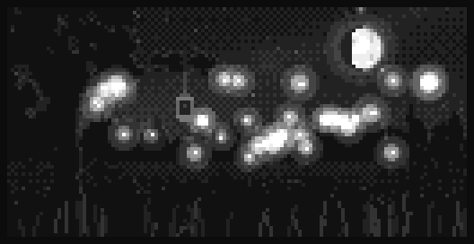
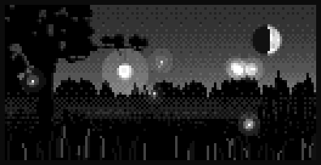

# fireflies

A summer meadow at night, where fireflies learn to flash together. Each one
keeps its own time and flashes a small bell; each flash nudges the ones
nearby a little ahead. Nobody leads — and out of scattered sparks the
meadow comes to blink in waves, then as one, until a gust of wind scatters
them again. Under it all, crickets that chirp faster when the night is
warm, frogs, an owl, and the first birds at dawn.

## Install

- **norns-js**: open the scripts store (the bag button, top right), find it on the *made for
  norns-js* shelf, press **get**, then **restart** when the page asks.
- **norns**: in maiden, `;install https://github.com/pinktentacle/fireflies`,
  then SYSTEM > RESTART once so its engine is loaded.

## Play

| | |
|---|---|
| E1 | the hour of the night, dusk to dawn |
| E2 | coupling: how much they listen to each other |
| E3 | how many fireflies |
| K2 | the lantern: a steady light on the beat, which they come to follow |
| K3 | a gust of wind |
| K1 + E1 | the wind |
| K1 + E2 | reach: how far a flash is seen |
| K1 + E3 | period: how often each one flashes |
| K1 + K2 | scatter them: everyone's clock to a random place |
| K1 + K3 | change voice |

The moon waxes as they come together and wanes as they scatter. With the
night set to go by on its own (*the night goes by*, in PARAMETERS), the sky
turns from dusk to dawn over half an hour; fireflies come out with the dark
and are gone by first light.

**Grid** (optional): the meadow itself. Fireflies light their keys as they
flash; tap an empty key to let a firefly go there, tap a lit one to catch
it, hold a key to plant the lantern there.

**MIDI**: every note can go out to a synth (*notes out to*, with channel,
note length and velocity range), and notes coming in are *calls*: a light
flashed into the meadow at the note's place, which the fireflies answer —
play slowly and they fall in with you.

## Parameters

- **fireflies** — the hour, the night going by on its own, how many,
  coupling, reach, period, tempo spread, drift, flash length, trails, the
  moon (follows the swarm, the real moon tonight, full or new)
- **weather** — wind, how often it gusts and how hard, the temperature
  (warmer: faster crickets and faster fireflies)
- **music** — scale, root, octaves, pitch from height, column or each
  firefly its own, voice (glass, bell, kalimba, breath, pluck or mixed),
  brightness, decay, notes a second, what happens when they flash as one
  (a chord, a swell, or nothing), the lantern's beat
- **the meadow** — crickets, frogs, wind in the grass, owls, birds at dawn,
  shooting stars
- **space** — reverb, echo level, feedback and time, volume
- **midi** and **grid**

## How it works

Each firefly is a pulse-coupled oscillator, after Mirollo and Strogatz
(1990): a clock that climbs to a flash, and a flash that pushes its
neighbours' clocks ahead along a concave curve, so that one pushed to the
top flashes in the same instant. That is enough for a meadow to
synchronise with no one in charge — as real fireflies do in the Great
Smoky Mountains and along the rivers of Thailand. Their flight while they
flash is the J of *Photinus pyralis*: a dip, then a climb.

## Licence

MIT, see [LICENSE](LICENSE).
