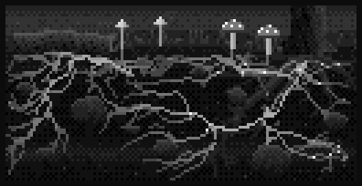
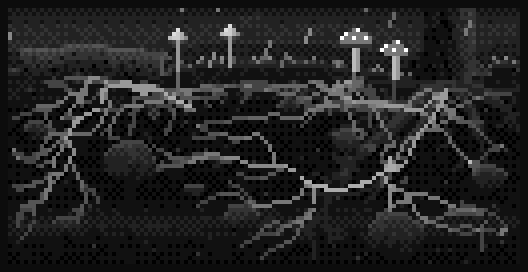

# mycelium

The forest floor cut through: under the leaves, a fungus grows. Its threads
feel their way through the soil toward food, fork, fuse into a net, trade
with the roots of an oak, and in autumn push mushrooms up into the air.
Signals run along the net, hop by hop, and every fork they pass through
rings. Feed it, touch it, cut it, sow it: it answers, and it remembers
where it has been fed.

## Install

- **norns-js**: open the scripts store (the bag button, top right), find it on the *made for
  norns-js* shelf, press **get**, then **restart** when the page asks.
- **norns**: in maiden, `;install https://github.com/pinktentacle/mycelium`,
  then SYSTEM > RESTART once so its engine is loaded.

## Play

| | |
|---|---|
| E1 | the season: scrub through the year |
| E2 / E3 | move through the soil |
| K2 | feed it: leaf litter here, which the threads turn toward |
| K3 | touch the net here: a signal runs out from the nearest thread |
| hold K3 | keep touching, on the beat |
| K1 + K2 | plant a spore here: a new colony |
| K1 + K3 | cut the threads here, and what hung from them withers; at the surface, pick a mushroom |
| K1 + E1 | how fast it grows |
| K1 + E2 | scale |
| K1 + E3 | root note |

Two fungi live here from the start: bonnets by the fallen log, which they
slowly eat, and fly agarics by the oak, whose roots they trade with — sugar
from the tree comes back as a signal now and then. A third kind, the
parasol, comes from a spore you plant. Mushrooms open in their season and
shed spores; the wind carries them, and some take root.

With the year set to go by on its own (*the year goes by in*, in
PARAMETERS), spring comes round every 20 minutes: shoots and fast growth in
spring, fruiting in autumn, litter falling, a thin net under the snow in
winter. Showers come and go; rain makes it grow faster.

**Grid** (optional): the soil, sixteen columns by eight layers. Signals light
the keys as they pass (and the threads, dimly, if *grid shows* says so),
litter glows, mushrooms light the top row. Tap a key to touch the net
there, or to drop litter where there is none; hold a key to plant a spore.

**MIDI**: every note can go out to a synth (*notes out to*, with channel,
note length and velocity range), and notes coming in are touches: a thread
whose note is the one you played rings, and the net carries it.

## Parameters

- **mycelium** — the season, the year going by, growth, branching, how far
  it smells food, crowding, how much of it there can be, dying back, how
  many colonies, how often a spore takes, fruiting, how many mushrooms
- **signals** — how fast they travel, how far they reach, how often the
  net signals by itself, how often holding K3 touches
- **weather** — rain (never, now and then, often, always), wind
- **music** — scale, root, octaves, pitch from depth, from distance along
  the net or from across, voice (wood, drop, glass, bow, pluck or each
  colony its own), brightness, decay, notes a second, what a mushroom
  opening sounds (a chord, a swell, or nothing), level, stereo width
- **the ground** — a drone that opens as the net grows, the crackle of
  life in the soil, rain
- **space** — reverb, echo level, feedback and time, volume
- **midi** and **grid**

## How it works

Each growing tip is a walker that keeps its heading, turns toward food it
can smell and around stones, and lays down a thread as it goes. Leaders
throw out short side branches at a sharp angle, which is what makes the
net look feathery. A tip that meets a far part of its own colony fuses with
it (anastomosis, a loop in the net); one that meets another colony stops.
Food the net has grown into is digested where it lies; a colony that has
eaten grows new tips where it is thinnest, and old ends nobody uses die
back, so the net keeps renewing itself.

Signals are waves through that graph: from where they start they spread to
every neighbour at the signal's speed, weaker at each hop, and the nodes
that matter — forks, fusions, tips, roots, the foot of a mushroom — play a
note as a wave reaches them. Fungi do carry electrical spikes along their
hyphae; here they are made audible, and slowed down to be heard.

## Licence

MIT, see [LICENSE](LICENSE).
