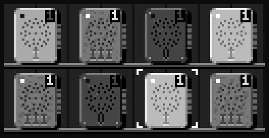
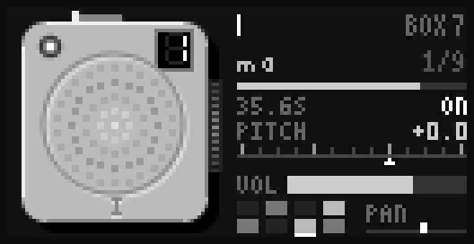

# nianfo

A wall of loop boxes for norns, after the little Buddha Machines that play
one drone, round and round, through a coin-sized speaker. Eight boxes, each
with any of the loops of six editions, each at its own pitch and volume —
played together, through the box's speaker, tape wobble, a tired battery,
echo and a large room.

## Install

- **norns-js**: open the scripts store (the bag button, top right), find it on the *made for
  norns-js* shelf, press **get**, then **restart** when the page asks.
- **norns**: in maiden, `;install https://github.com/pinktentacle/nianfo`,
  then SYSTEM > RESTART once so its engine is loaded.

## Play

| | |
|---|---|
| E1 | choose a box |
| E2 | its pitch |
| E3 | its volume |
| K2 | its next loop |
| K3 | switch it on or off |
| K1 + E1 | its edition |
| K1 + E2 | its pan |
| K1 + K3 | the next view: the wall, one box close, the effects |

On the effects view, E1 chooses a knob and E2 / E3 turn it. A grid, if
there is one, has a column pair for each box.

## Credits

The loops of editions I and II are **FM3**'s (Christiaan Virant and Zhang
Jian), from their first and second Buddha Machines, under the Creative
Commons Attribution-NonCommercial-ShareAlike 3.0 licence, adapted here and
shared under the same licence. Editions III to SE are made for this script.
Not affiliated with FM3.

Licences: see [LICENSE](LICENSE) — MIT for the script, CC BY-NC-SA 3.0 for
FM3's loops.
