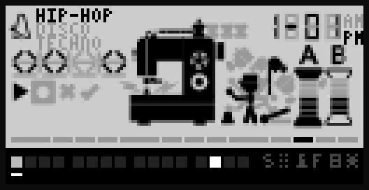
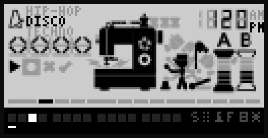

# no12

A pocket operator rhythm machine for norns: sixteen sounds, sixteen steps,
sixteen patterns, and the PO-12's effects, on a screen drawn like its LCD —
the sewing machine and the drummer included.

## Install

- **norns-js**: open the scripts store (the bag button, top right), find it on the *made for
  norns-js* shelf, press **get**, then **restart** when the page asks.
- **norns**: in maiden, `;install https://github.com/pinktentacle/no12`,
  then SYSTEM > RESTART once so its engine is loaded.

## Play

The PO-12 is played with chords — hold a button, press another. On norns a
"finger" points at a button:

| | |
|---|---|
| E1 | move the finger: buttons 1–16, sound, pattern, bpm, FX, write, special |
| K2 | press the button under the finger (hold it for a chord) |
| K2 held, E1 then K3 | a second finger: K3 presses what it points at |
| K3 | play / stop |
| K1 | write, held |
| E2 / E3 | knobs A / B of the sound |
| K1 + K3 | next tempo |

To choose a sound: finger on *sound*, hold K2, turn E1 to a number, press
K3. To write it: hold K1 and press the steps. Everything in the PO-12's own
guide works the same way. A grid plays like the device, with real chords.

## Credits

Began as a port of [ulnd/po-12](https://github.com/ulnd/po-12), Jake
Chvatal's browser version of the PO-12 (MIT). pocket operator and PO-12 are
Teenage Engineering's; this is not affiliated with them, and is for personal
use.

Licence: MIT, see [LICENSE](LICENSE).
