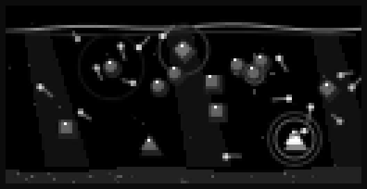
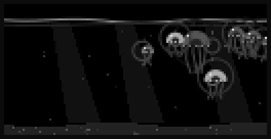

# remous

Three pools of small creatures that make music as you play with them —
swimmers that ring the stones they brush, jellyfish that sing as they pulse,
bubbles that chime when they break at the surface.

## Install

- **norns-js**: open the scripts store (the bag button, top right), find it on the *made for
  norns-js* shelf, press **get**, then **restart** when the page asks.
- **norns**: in maiden, `;install https://github.com/pinktentacle/remous`,
  then SYSTEM > RESTART once so its engine is loaded.

## Play

| | |
|---|---|
| K1 + E1 | change pool: stones, jellies, bubbles |
| E1 | the current of the water |
| E2 / E3 | move the cursor |
| K2 | stones: place a stone (again: change its sound) · jellies: drop food · bubbles: open a vent |
| K3 | let a creature go · bubbles: hold to blow one |
| K1 + E2 / E3 | scale / root note |

A stone's height is its note and its shape its sound. Creatures that make
music grow and multiply; the others tire and fade. A grid, if there is one,
is the pool itself.

## Licence

MIT, see [LICENSE](LICENSE).
